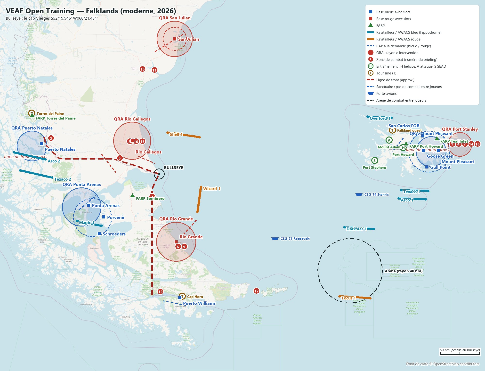
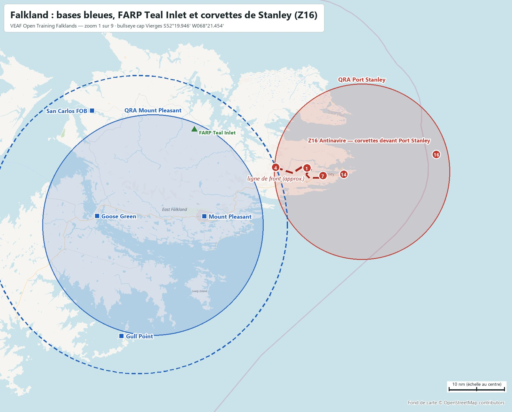
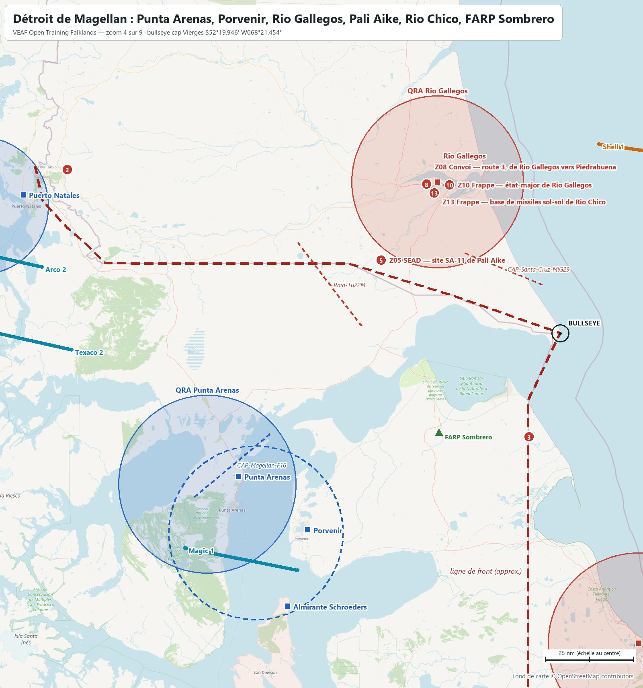
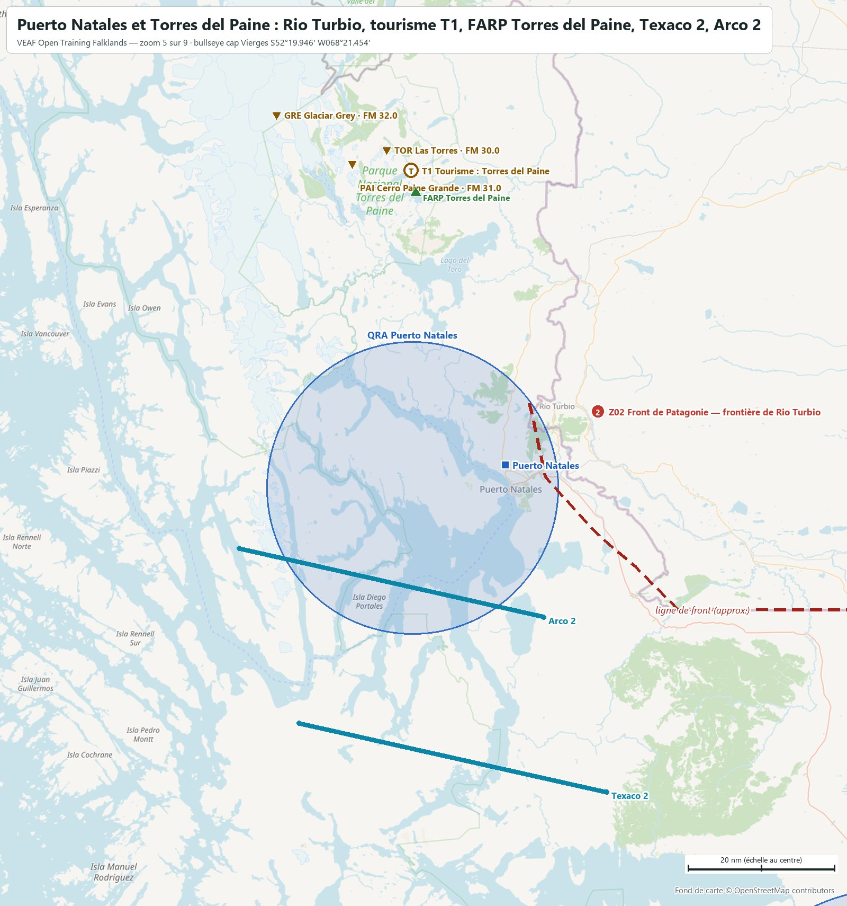
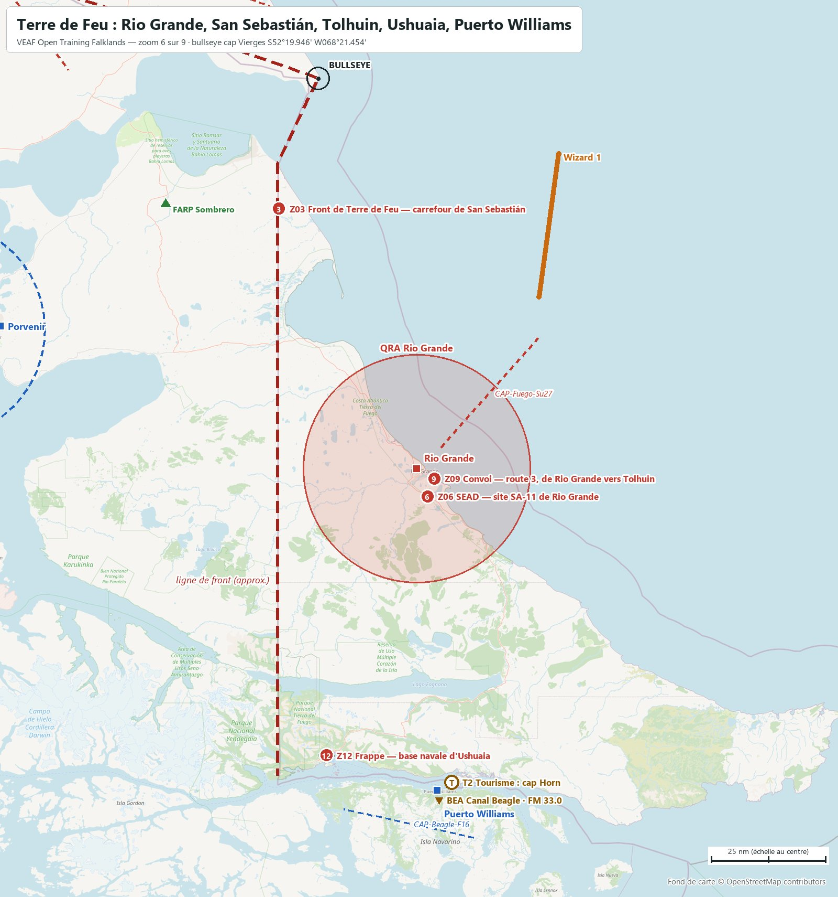
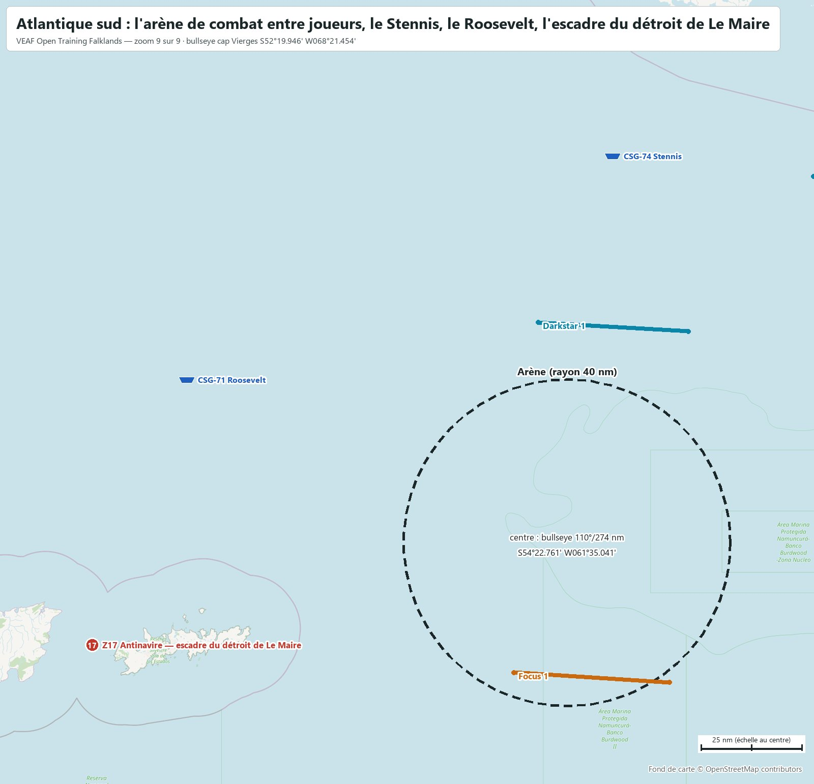
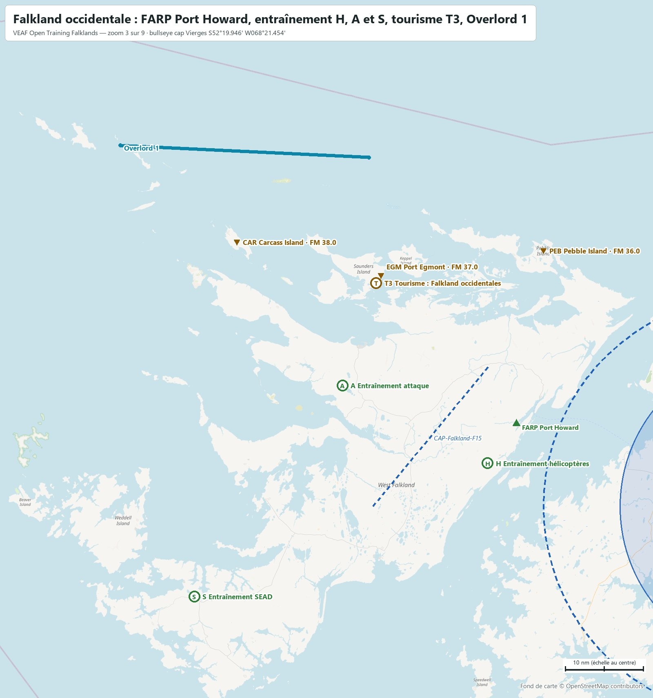
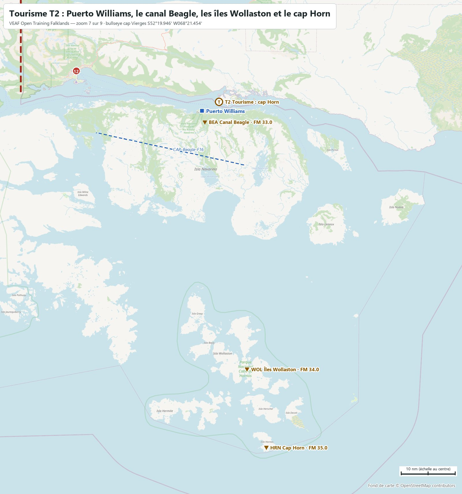
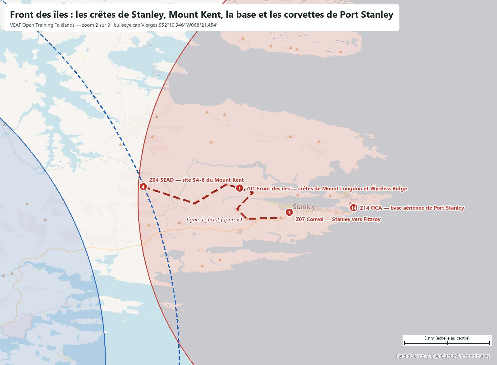
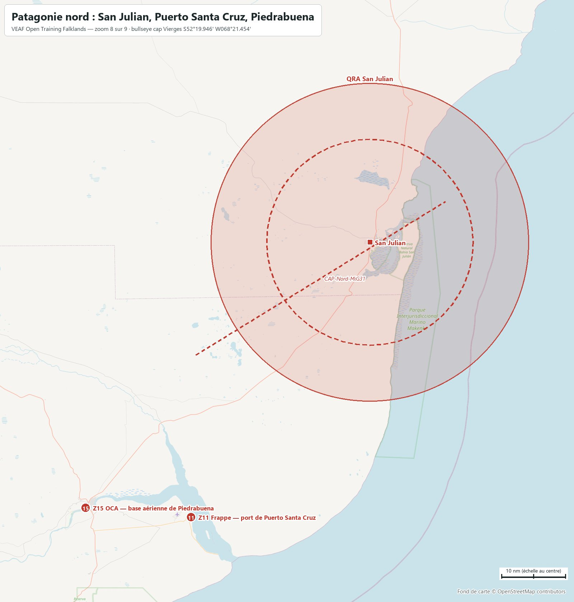

# VEAF Open Training — Falklands (moderne, 2026)

Mission d'entraînement ouverte des serveurs VEAF, sur la carte **Falklands** de DCS, dans un scénario moderne. Ce document est le briefing complet : bases, soutien, zones, QRA, CAP, radio, météo. Les positions sont données en coordonnées (degrés, minutes décimales) et en relèvement/distance depuis le bullseye (relèvement vrai, nautiques).

| Mission | Date | Heure de base | Bullseye (bleu et rouge) | Météo | ATC |
|---|---|---|---|---|---|
| `VEAF_OpenTraining_Falklands_ICAO_EGYP` | 15/10/2026 | 09:00 (heure de la carte, UTC-3) | le cap Vierges · `S52°19.946' W068°21.454'` | celle du serveur VEAF | coupé sur tous les aérodromes |

**Sommaire** : [Situation](#situation) · [Carte](#carte) · [Bases](#bases) · [Ravitailleurs et AWACS](#ravitailleurs-et-awacs) · [Porte-avions](#porte-avions) · [Drones laser](#drones-laser) · [Entraînement](#entraînement) · [Tourisme](#tourisme) · [Zones de combat](#zones-de-combat) · [Missions scénarisées](#missions-scénarisées) · [QRA](#qra) · [CAP à la demande](#cap-à-la-demande) · [Combat entre joueurs](#combat-entre-joueurs) · [Défense aérienne](#défense-aérienne) · [Plan radio](#plan-radio) · [Météo et heures](#météo-et-heures) · [Commandes utiles](#commandes-utiles) · [Pour les créateurs de mission](#pour-les-créateurs-de-mission)

## Situation

Une force hostile tient la côte atlantique de la Patagonie et de la Terre de Feu argentines, ainsi que Port Stanley. Le Royaume-Uni (les îles Falkland) et le Chili, appuyés par les États-Unis et deux groupes aéronavals — le Stennis et le Roosevelt, dans l'Atlantique sud —, la prennent en tenaille. Deux fronts : la frontière chilo-argentine, de Puerto Natales à Puerto Williams (328 nm, tracé approximatif), tenue côté bleu par les bases chiliennes ; et le cordon de crêtes à l'ouest de Port Stanley (11 nm), face aux bases britanniques de la Falkland orientale. Les deux théâtres sont séparés par la mer : 406 nm de Mount Pleasant à Rio Gallegos, qu'il faut franchir avec les ravitailleurs ; les porte-avions croisent entre les deux. Le bullseye commun est le cap Vierges, sur la frontière, à l'entrée atlantique du détroit de Magellan : un repère que tous les pilotes savent nommer.

Au Chili, la frontière est serrée : Puerto Natales n'est qu'à 12 nm de Rio Turbio (terrain rouge sans slots), Puerto Williams à 24 nm d'Ushuaia, et Punta Arenas à 102 nm de Rio Gallegos. Aux îles, Port Stanley (rouge, sans slots) est à 27 nm de Mount Pleasant, la base mère.

La version 5 (2025) ne contenait ni zone, ni défense, ni soutien : des modèles de spawn, des modèles de slots dynamiques, et trois modules exigés (A-4E-C, OV-10A, Hercules) que la v6 n'exige plus. Elle a donné la carte ; le reste est construit pour cette v6.

Zones de combat, missions et soutien se pilotent par le menu radio F10 (*Zones de combat*, *Missions de combat*, *Assets*).

## Carte



Cartes zoomées, reprises dans les sections qu'elles illustrent : [Falkland](docs/cartes/carte_01_falkland.jpg) · [Front des îles](docs/cartes/carte_02_stanley.jpg) · [Falkland occidentale](docs/cartes/carte_03_falkland_ouest.jpg) · [Détroit de Magellan](docs/cartes/carte_04_magellan.jpg) · [Puerto Natales et Torres del Paine](docs/cartes/carte_05_natales.jpg) · [Terre de Feu](docs/cartes/carte_06_fuego.jpg) · [Tourisme T2](docs/cartes/carte_07_caphorn.jpg) · [Patagonie nord](docs/cartes/carte_08_nord.jpg) · [Atlantique sud](docs/cartes/carte_09_arene.jpg).

Carrés : bases avec slots (bleu / rouge). Triangles verts : FARP. Triangles bruns : balises du tourisme. Traits pleins : hippodromes des ravitailleurs et AWACS. Pointillés fins : CAP à la demande. Cercles pleins : QRA. Pastilles vertes : entraînement (H hélicoptères, A attaque, S SEAD). Pastilles brunes T : tourisme. Pastilles rouges numérotées : zones de combat. Cercles en tirets : sanctuaires et arène. Navires : porte-avions. Fond OpenStreetMap ; les lignes de front sont approximatives. Le briefing DCS montre cette carte puis les zooms (flèches sous l'image, molette pour grossir) ; la carte F10 porte les mêmes dessins : front, zones, QRA, sanctuaires et arène pour les deux camps, hippodromes de soutien pour leur camp seulement.

## Bases

| Base | Camp | Position | Bullseye | UHF | VHF | FM | Défense |
|---|---|---|---|---|---|---|---|
| **Almirante Schroeders** | Bleu | `S53°36.416' W070°28.572'` | `215°/109 nm` | `229.0` | `118.25` | `38.6` | NASAMS + Avenger |
| **Goose Green** | Bleu | `S51°49.189' W058°58.810'` | `080°/349 nm` | `250.65` | `126.0` | `39.05` | Hawk + Rapier |
| **Gull Point** | Bleu | `S52°10.763' W058°51.641'` | `083°/351 nm` | `234.5` | `126.5` | `39.5` | NASAMS + Avenger |
| **Mount Pleasant** (base mère) | Bleu | `S51°49.241' W058°27.464'` | `080°/368 nm` | `250.8` | `133.35` | `39.2` | Patriot + Rapier + Avenger |
| **Porvenir** | Bleu | `S53°15.221' W070°19.158'` | `222°/91 nm` | `250.4` | `126.7` | `38.8` | Hawk + Avenger |
| **Puerto Natales** | Bleu | `S51°40.243' W072°31.691'` | `274°/161 nm` | `250.15` | `128.1` | `38.55` | Hawk + NASAMS + Avenger |
| **Puerto Williams** | Bleu | `S54°55.859' W067°37.573'` | `162°/159 nm` | `250.1` | `118.5` | `38.5` | Hawk + NASAMS + Avenger |
| **Punta Arenas** | Bleu | `S53°00.332' W070°51.415'` | `236°/101 nm` | `251.1` | `118.7` | `39.5` | Patriot + Hawk + Avenger + Radar d'alerte FPS-117 |
| **San Carlos FOB** | Bleu | `S51°30.077' W059°00.295'` | `077°/352 nm` | `250.85` | `134.35` | `39.25` | Hawk + Avenger |
| **Rio Gallegos** | Rouge | `S51°36.531' W069°18.735'` | `311°/57 nm` | `250.9` | `119.1` | `39.3` | SA-10 + SA-15 + Radar d'alerte 55G6 |
| **Rio Grande** | Rouge | `S53°46.656' W067°44.993'` | `157°/90 nm` | `250.95` | `118.3` | `39.35` | SA-11 + SA-15 + Radar d'alerte 55G6 |
| **San Julian** | Rouge | `S49°18.402' W067°48.163'` | `358°/184 nm` | `250.05` | `118.05` | `38.45` | SA-11 + SA-15 + Radar d'alerte 55G6 |
| **FARP Port Howard** | Bleu | `S51°40.134' W059°36.086'` | `077°/328 nm` | — | — | `127.5` | dépôt de munitions (CTLD) |
| **FARP Teal Inlet** | Bleu | `S51°33.460' W058°30.351'` | `078°/369 nm` | — | — | `128.0` | dépôt de munitions (CTLD) |
| **FARP Torres del Paine** | Bleu | `S51°02.702' W072°51.388'` | `284°/187 nm` | — | — | `129.5` | dépôt de munitions (CTLD) |
| **FARP Sombrero** | Bleu | `S52°48.000' W069°18.000'` | `221°/45 nm` | — | — | `129.0` | dépôt de munitions (CTLD) |

Slots dynamiques, démarrage moteur chaud, carburant et munitions illimités. Les autres aérodromes de chaque camp lui appartiennent, sans slots : côté bleu les autres terrains du Chili austral (Franco Bianco, Pampa Guanaco, O'Higgins) ; côté rouge tous les autres terrains argentins de la carte et Port Stanley. Aucun terrain n'est neutre. Fréquences : celles que DCS donne à chaque tour (ATC coupé). La colonne FM des FARP est leur fréquence VHF AM.

<table><tr><td width="50%"><a href="docs/cartes/carte_01_falkland.jpg"></a><br><sub>Falkland : bases bleues, FARP Teal Inlet et corvettes de Stanley (Z16)</sub></td><td width="50%"><a href="docs/cartes/carte_04_magellan.jpg"></a><br><sub>Détroit de Magellan : Punta Arenas, Porvenir, Rio Gallegos, Pali Aike, Rio Chico, FARP Sombrero</sub></td></tr><tr><td width="50%"><a href="docs/cartes/carte_05_natales.jpg"></a><br><sub>Puerto Natales et Torres del Paine : Rio Turbio, tourisme T1, FARP Torres del Paine, Texaco 2, Arco 2</sub></td><td width="50%"><a href="docs/cartes/carte_06_fuego.jpg"></a><br><sub>Terre de Feu : Rio Grande, San Sebastián, Tolhuin, Ushuaia, Puerto Williams</sub></td></tr></table>

## Ravitailleurs et AWACS

| Indicatif | Camp | Appareil | Rôle | UHF | TACAN | Niveau | Bullseye (milieu) | Hippodrome (extrémités) | Escorte |
|---|---|---|---|---|---|---|---|---|---|
| **Texaco 1** | Bleu | KC-135 | perche · îles | `290.0` | `50Y` | `FL220` | `088°/334 nm` | `S52°40.868' W059°46.552'`<br>`S52°41.985' W058°48.897'` | oui |
| **Arco 1** | Bleu | KC135MPRS | panier · îles | `291.0` | `51Y` | `FL180` | `090°/331 nm` | `S52°51.537' W059°51.690'`<br>`S52°52.698' W058°53.802'` | oui |
| **Texaco 2** | Bleu | KC-135 | perche · Chili | `292.0` | `52Y` | `FL240` | `259°/162 nm` | `S52°24.588' W072°09.268'`<br>`S52°15.333' W073°17.073'` | oui |
| **Arco 2** | Bleu | KC135MPRS | panier · Chili | `293.0` | `53Y` | `FL200` | `267°/173 nm` | `S52°00.966' W072°23.134'`<br>`S51°51.631' W073°30.268'` | oui |
| **Magic 1** | Bleu | E-3A | AWACS · Chili | `283.0` | — | `FL300` | `225°/111 nm` | `S53°20.278' W071°16.541'`<br>`S53°26.491' W070°23.982'` | oui |
| **Darkstar 1** | Bleu | E-3A | AWACS · arène | `285.0` | — | `FL300` | `099°/268 nm` | `S53°28.301' W061°47.222'`<br>`S53°30.556' W060°44.094'` | non |
| **Overlord 1** | Bleu | E-3A | AWACS · îles | `282.0` | — | `FL300` | `070°/302 nm` | `S51°04.379' W060°57.815'`<br>`S51°05.933' W060°06.514'` | oui |
| **Shell 1** | Rouge | IL-78M | ravitailleur rouge | `294.0` | — | `FL200` | `023°/61 nm` | `S51°25.554' W068°03.406'`<br>`S51°31.702' W066°55.445'` | oui |
| **Wizard 1** | Rouge | A-50 | AWACS rouge | `284.0` | — | `FL300` | `114°/62 nm` | `S52°36.934' W066°52.443'`<br>`S53°08.811' W066°59.803'` | oui |
| **Focus 1** | Rouge | A-50 | AWACS rouge · arène | `286.0` | — | `FL300` | `116°/294 nm` | `S54°54.271' W061°57.354'`<br>`S54°56.647' W060°52.014'` | non |

Les ravitailleurs et AWACS du théâtre sont escortés (F-15C aux îles, F-16C au Chili, Su-27 côté rouge). Marqueurs F10 : `-tanker <nom>` amène un ravitailleur au marqueur ; `-tankerlow` et `-tankerhigh` mettent le plus proche au FL120 ou au FL220.

## Porte-avions

| Navire | Position de départ | Bullseye | TACAN | ICLS | Link 4 | Tour | Slots sur le pont |
|---|---|---|---|---|---|---|---|
| **CSG-74 Stennis** (2 escorteurs) | `S52°46.308' W061°15.881'` | `090°/262 nm` | `74X STN` | `11` | `336.0` | `305.0` | 4 × F/A-18C, 2 × F-14B |
| **CSG-71 Roosevelt** (2 escorteurs) | `S53°42.478' W064°14.517'` | `112°/171 nm` | `71X RSV` | `12` | `337.0` | `306.0` | 2 × F/A-18C, 4 × F-14B |



Le Stennis au sud des Falkland, le Roosevelt au large de la Terre de Feu. Slots à froid et à chaud sur les ponts, plus les slots dynamiques. Le menu F10 *CARRIER OPS* met chaque porte-avions face au vent, avec son ravitailleur S-3B (Stennis 56Y U296.0, Roosevelt 57Y U297.0) et son hélicoptère de sauvetage.

## Drones laser

| Drone | Appareil | Au-dessus de | Code laser | Radio | Hauteur | Bullseye |
|---|---|---|---|---|---|---|
| **Reaper 2** | MQ-9 Reaper | front de Rio Turbio | `1512` | `35.6 FM` | `3 000 m sol` | `278°/151 nm` |
| **Reaper 1** | MQ-9 Reaper | champ de tir d'attaque | `1511` | `35.55 FM` | `3 000 m sol` | `076°/307 nm` |

Reaper 1 tourne au-dessus du champ de tir d'attaque de Mount Adam, Reaper 2 au-dessus de la ligne de Rio Turbio (Z02), et chacun désigne au laser ce qu'il voit. CTLD le maintient à 3 000 m sol : l'artillerie antiaérienne de la zone peut l'abattre, et le menu F10 *Assets* le remet en vol. Il ne désigne que des véhicules — ce que sont aussi les cibles des niveaux faciles — et ne marque qu'à 10 km. Pas de drone sur une zone dont les SAM portent plus loin que le laser.

## Entraînement

Sur la Falkland occidentale, à quelques minutes des bases britanniques et loin du front de Stanley. Trois niveaux par famille, chacun comprenant ceux d'en dessous. **Activez un seul niveau par famille à la fois.** Les cibles des niveaux faciles sont des véhicules immobiles, en tir interdit : chauds au pod, inertes.



### Hélicoptères — Port Howard (près du FARP Port Howard)

`S51°45.261' W059°42.032'` · bullseye `078°/323 nm` · rayon 1.3 nm · menu F10 « Entraînement hélicoptères » · Arco 1 (panier, TACAN 51Y, 291.0) à 67 nm ; Texaco 1 (perche, TACAN 50Y, 290.0) à 56 nm

- **H1 Hélico Port Howard — facile** — Champ de tir hélicoptères de la Falkland occidentale, à 6 nm au sud-ouest du FARP Port Howard : cibles inertes (chars, blindés et camions immobiles, tir interdit).
- **H2 Hélico Port Howard — moyen** — Champ de tir hélicoptères de la Falkland occidentale : de l'artillerie antiaérienne légère (ZU-23, parfois un Shilka) en plus des cibles du niveau facile.
- **H3 Hélico Port Howard — difficile** — Champ de tir hélicoptères de la Falkland occidentale, avec une défense courte portée réaliste : un SA-13 et une équipe de lance-missiles portatifs SA-18, à guidage infrarouge.

### Attaque — Mount Adam (à l'ouest de la montagne)

`S51°35.334' W060°11.981'` · bullseye `076°/307 nm` · rayon 1.3 nm · menu F10 « Entraînement attaque » · Arco 1 (panier, TACAN 51Y, 291.0) à 77 nm ; Texaco 1 (perche, TACAN 50Y, 290.0) à 67 nm

- **A1 Attaque Mount Adam — facile** — Champ de tir air-sol à l'ouest de Mount Adam, sur la Falkland occidentale, à 78 nm du front de Stanley : blindés et camions immobiles en tir interdit, dépôt de carburant et poste de commandement. Le drone Reaper 1 tourne au-dessus.
- **A2 Attaque Mount Adam — moyen** — Champ de tir de Mount Adam : une compagnie blindée active et de l'artillerie antiaérienne légère en plus des cibles du niveau facile.
- **A3 Attaque Mount Adam — difficile** — Champ de tir de Mount Adam : un second groupe blindé et une défense courte portée à guidage infrarouge (SA-13 ou SA-9), avec un Shilka.

### SEAD — Port Stephens (sud-ouest de la Falkland occidentale)

`S52°02.229' W060°42.557'` · bullseye `080°/284 nm` · rayon 1.6 nm · menu F10 « Entraînement SEAD » · Arco 1 (panier, TACAN 51Y, 291.0) à 58 nm ; Texaco 1 (perche, TACAN 50Y, 290.0) à 52 nm

- **S1 SEAD Port Stephens — facile** — Site SEAD au sud-ouest de la Falkland occidentale, près de Port Stephens, à 33 nm du champ de tir d'attaque : une batterie sol-air moyenne portée, SA-6 ou SA-11 tirée au sort.
- **S2 SEAD Port Stephens — moyen** — Site SEAD de Port Stephens : la batterie moyenne portée est protégée par une défense courte portée (SA-15, SA-8).
- **S3 SEAD Port Stephens — difficile** — Site SEAD de Port Stephens en réseau Skynet : un radar d'alerte avancée guide les batteries, qui restent éteintes jusqu'au dernier moment.

## Tourisme

Trois circuits hors combat, avec leurs balises radio FM en morse et un guide qui parle à tout appareil d'un joueur qui passe sous 1 500 ft sol au-dessus d'un site : un message par site, renouvelé après 10 minutes. Les zones F10 *Tourisme* font seulement apparaître des véhicules à l'accueil ; le circuit, les balises et le guide sont là en permanence. La présence de chaque site dans le décor DCS est à confirmer en jeu ; les textes du guide sont des connaissances générales, à relire.

### T1 — Torres del Paine

`S50°59.747' W072°52.415'` · bullseye `285°/189 nm` · menu F10 « Tourisme »

Visite aérienne de la Patagonie des glaciers, hors combat, au départ du FARP Torres del Paine (3 nm au nord-ouest). Circuit : les tours de granit (Las Torres), les Cuernos et le Paine Grande, puis le lac Grey et son glacier, un front de la grande calotte glaciaire de Patagonie. Une balise radio FM à chaque site ; survolez un site à moins de 1 500 ft sol et un guide vous le raconte. Excursion : le glacier Perito Moreno, de l'autre côté de la frontière, en territoire rouge (aucune défense permanente).

| Balise | Site | FM | Position |
|---|---|---|---|
| **TOR** | Las Torres | `30.0` | `S50°56.913' W072°57.734'` |
| **PAI** | Cerro Paine Grande | `31.0` | `S50°58.871' W073°05.334'` |
| **GRE** | Glaciar Grey | `32.0` | `S50°52.075' W073°22.022'` |

Sites du guide : Las Torres, Les Cuernos, Cerro Paine Grande, Glaciar Grey, Glaciar Perito Moreno. Chaque balise répète son indicatif en morse.


### T2 — le bout du monde

`S54°54.187' W067°32.047'` · bullseye `160°/158 nm` · menu F10 « Tourisme »

Visite aérienne du bout du monde, hors combat, au départ de Puerto Williams. Circuit : le canal Beagle, les îles Wollaston et le cap Horn. Une balise radio FM par site ; survolez-les à moins de 1 500 ft sol pour entendre le guide. Le circuit reste côté chilien, à plus de 20 nm de la base argentine d'Ushuaia.

| Balise | Site | FM | Position |
|---|---|---|---|
| **BEA** | Canal Beagle | `33.0` | `S54°57.975' W067°36.669'` |
| **WOL** | Îles Wollaston | `34.0` | `S55°43.706' W067°22.903'` |
| **HRN** | Cap Horn | `35.0` | `S55°57.990' W067°16.676'` |

Sites du guide : Canal Beagle, Îles Wollaston, Cap Horn. Chaque balise répète son indicatif en morse.



### T3 — Falkland occidentales

`S51°22.163' W060°05.025'` · bullseye `074°/314 nm` · menu F10 « Tourisme »

Visite aérienne des Falkland occidentales, hors combat, au départ du FARP Port Howard (26 nm au nord-ouest). Circuit : Pebble Island, Saunders Island et Port Egmont, Carcass Island. Une balise radio FM par site ; survolez-les à moins de 1 500 ft sol pour entendre le guide.

| Balise | Site | FM | Position |
|---|---|---|---|
| **PEB** | Pebble Island | `36.0` | `S51°17.969' W059°30.489'` |
| **EGM** | Port Egmont | `37.0` | `S51°21.181' W060°04.061'` |
| **CAR** | Carcass Island | `38.0` | `S51°16.874' W060°33.721'` |

Sites du guide : Pebble Island, Port Egmont, Carcass Island. Chaque balise répète son indicatif en morse.

## Zones de combat

Les numéros renvoient à la carte. Chaque zone s'active par le menu F10 *Zones de combat*, qui redonne son briefing et sa position. Une partie des sites change d'une activation à l'autre (batterie tirée au sort, groupes blindés tirés au sort). Le secteur des îles (Z01, Z04, Z07, Z14, Z16) est proche de Mount Pleasant : courte portée seulement, SA-6 au plus.

<table><tr><td width="50%"><a href="docs/cartes/carte_02_stanley.jpg"></a><br><sub>Front des îles : les crêtes de Stanley, Mount Kent, la base et les corvettes de Port Stanley</sub></td><td width="50%"><a href="docs/cartes/carte_04_magellan.jpg"></a><br><sub>Détroit de Magellan : Punta Arenas, Porvenir, Rio Gallegos, Pali Aike, Rio Chico, FARP Sombrero</sub></td></tr><tr><td width="50%"><a href="docs/cartes/carte_05_natales.jpg"></a><br><sub>Puerto Natales et Torres del Paine : Rio Turbio, tourisme T1, FARP Torres del Paine, Texaco 2, Arco 2</sub></td><td width="50%"><a href="docs/cartes/carte_06_fuego.jpg"></a><br><sub>Terre de Feu : Rio Grande, San Sebastián, Tolhuin, Ushuaia, Puerto Williams</sub></td></tr><tr><td width="50%"><a href="docs/cartes/carte_08_nord.jpg"></a><br><sub>Patagonie nord : San Julian, Puerto Santa Cruz, Piedrabuena</sub></td></tr></table>

### Front

**Z01 Front des îles — crêtes de Mount Longdon et Wireless Ridge** — `S51°40.508' W057°57.460'` · bullseye `079°/388 nm`

Les crêtes à l'ouest de Port Stanley, tenues par une brigade mécanisée rouge : chars, blindés et lance-roquettes en position, à 21 nm de Mount Pleasant. Détruire les blindés et l'artillerie ; défense courte portée (SA-15, SA-13) et artillerie antiaérienne, sous la QRA de Port Stanley. Ravitailleurs : Arco 1 (panier, TACAN 51Y, 291.0) à 80 nm ; Texaco 1 (perche, TACAN 50Y, 290.0) à 69 nm.

**Z02 Front de Patagonie — frontière de Rio Turbio** — `S51°32.940' W072°11.178'` · bullseye `278°/151 nm`

La ligne de défense rouge de Rio Turbio, à 15 nm de Puerto Natales, côté argentin : chars enterrés, blindés et artillerie automotrice. Défense courte portée seulement (SA-13, Shilka) : le drone Reaper 2 la désigne au laser. Ravitailleurs : Arco 2 (panier, TACAN 53Y, 293.0) à 29 nm ; Texaco 2 (perche, TACAN 52Y, 292.0) à 51 nm.

**Z03 Front de Terre de Feu — carrefour de San Sebastián** — `S52°49.200' W068°36.000'` · bullseye `188°/31 nm`

Le poste frontière de San Sebastián, sur la route de Rio Grande, face au Chili : une brigade mécanisée rouge et ses lance-roquettes. Détruire les blindés et les Grad ; défense SA-8 et artillerie antiaérienne. Aucune QRA ne couvre le secteur (Rio Grande est à 66 nm). Ravitailleurs : Arco 2 (panier, TACAN 53Y, 293.0) à 149 nm ; Texaco 2 (perche, TACAN 52Y, 292.0) à 134 nm.

### SEAD

**Z04 SEAD — site SA-6 du Mount Kent** — `S51°40.408' W058°06.600'` · bullseye `079°/383 nm`

Le site SA-6 perché sur Mount Kent, au-dessus de la vallée de Stanley, relié à un radar d'alerte avancée en réseau Skynet, à 16 nm de Mount Pleasant. Détruire le radar de conduite de tir et les lanceurs ; un Shilka protège le site. Ravitailleurs : Arco 1 (panier, TACAN 51Y, 291.0) à 78 nm ; Texaco 1 (perche, TACAN 50Y, 290.0) à 67 nm.

**Z05 SEAD — site SA-11 de Pali Aike** — `S51°58.981' W069°44.932'` · bullseye `283°/56 nm`

Le site sol-air qui couvre la steppe de Pali Aike, entre Rio Gallegos et la frontière : une batterie SA-11 ou SA-6 tirée au sort, son radar d'alerte avancée et un Shilka. Sous la couverture lointaine du SA-10 de Rio Gallegos. Ravitailleurs : Arco 2 (panier, TACAN 53Y, 293.0) à 99 nm ; Texaco 2 (perche, TACAN 52Y, 292.0) à 93 nm.

**Z06 SEAD — site SA-11 de Rio Grande** — `S53°52.648' W067°41.041'` · bullseye `156°/97 nm`

Le site SA-11 au sud-sud-est de Rio Grande, sur la côte atlantique de la Terre de Feu, avec son radar d'alerte avancée en réseau Skynet et un SA-15. Détruire le radar de conduite de tir et les lanceurs. Ravitailleurs : Arco 2 (panier, TACAN 53Y, 293.0) à 206 nm ; Texaco 2 (perche, TACAN 52Y, 292.0) à 186 nm.

### Convois

**Z07 Convoi — Stanley vers Fitzroy** — `S51°41.919' W057°52.770'` · bullseye `080°/391 nm`

Un convoi de renforts quitte Port Stanley par la route de Fitzroy, vers le sud-ouest. L'arrêter avant Fitzroy, à 9 nm de Mount Pleasant ; il porte sa propre artillerie antiaérienne (ZU-23) et un SA-9. Ravitailleurs : Arco 1 (panier, TACAN 51Y, 291.0) à 80 nm ; Texaco 1 (perche, TACAN 50Y, 290.0) à 69 nm.

**Z08 Convoi — route 3, de Rio Gallegos vers Piedrabuena** — `S51°37.145' W069°23.720'` · bullseye `309°/58 nm`

Un convoi blindé quitte Rio Gallegos par la route 3 vers Piedrabuena pour renforcer le nord. Le détruire en route ; il est escorté par un SA-13, sous la QRA de Rio Gallegos au départ. Ravitailleurs : Arco 2 (panier, TACAN 53Y, 293.0) à 115 nm ; Texaco 2 (perche, TACAN 52Y, 292.0) à 114 nm.

**Z09 Convoi — route 3, de Rio Grande vers Tolhuin** — `S53°48.806' W067°38.563'` · bullseye `155°/93 nm`

Un convoi de carburant roule de Rio Grande vers Tolhuin, sur la route 3 de Terre de Feu, pour ravitailler le front de San Sebastián et du canal Beagle. Le détruire avant Tolhuin ; il porte sa propre artillerie antiaérienne. Ravitailleurs : Arco 2 (panier, TACAN 53Y, 293.0) à 205 nm ; Texaco 2 (perche, TACAN 52Y, 292.0) à 185 nm.

### Frappes en profondeur

**Z10 Frappe — état-major de Rio Gallegos** — `S51°37.356' W069°13.086'` · bullseye `314°/54 nm`

Le poste de commandement rouge du sud de la Patagonie, dans les faubourgs de Rio Gallegos : bunkers, centre de transmissions, dépôt de carburant. Tout détruire ; défense SA-15 et Shilka, sous la QRA et le SA-10 de Rio Gallegos. Ravitailleurs : Arco 2 (panier, TACAN 53Y, 293.0) à 122 nm ; Texaco 2 (perche, TACAN 52Y, 292.0) à 120 nm.

**Z11 Frappe — port de Puerto Santa Cruz** — `S50°01.198' W068°31.204'` · bullseye `349°/140 nm`

Le port de Puerto Santa Cruz, au bord de l'estuaire : entrepôts de munitions et de matériel, réservoirs. Tout détruire ; ZU-23 sur place, sous le SA-11 permanent de la ville. Ravitailleurs : Arco 2 (panier, TACAN 53Y, 293.0) à 191 nm ; Texaco 2 (perche, TACAN 52Y, 292.0) à 200 nm.

**Z12 Frappe — base navale d'Ushuaia** — `S54°48.438' W068°18.505'` · bullseye `170°/150 nm`

La base navale d'Ushuaia, sur le canal Beagle, à 24 nm de Puerto Williams : entrepôts, dépôts de carburant, poste de commandement. Tout détruire ; défense courte portée seulement (SA-15 permanent de la base, ZU-23), hors de la QRA de Rio Grande (65 nm). Ravitailleurs : Arco 2 (panier, TACAN 53Y, 293.0) à 225 nm ; Texaco 2 (perche, TACAN 52Y, 292.0) à 201 nm.

**Z13 Frappe — base de missiles sol-sol de Rio Chico** — `S51°39.692' W069°20.202'` · bullseye `309°/55 nm`

Une base de missiles sol-sol à l'ouest de Rio Chico, d'où les Scud menacent Punta Arenas : lanceurs et camions de ravitaillement. Détruire les lanceurs ; défense SA-15 et Shilka. Ravitailleurs : Arco 2 (panier, TACAN 53Y, 293.0) à 117 nm ; Texaco 2 (perche, TACAN 52Y, 292.0) à 115 nm.

### Bases aériennes

**Z14 OCA — base aérienne de Port Stanley** — `S51°41.640' W057°46.679'` · bullseye `080°/395 nm`

L'aérodrome de Port Stanley, tenu par le rouge à 27 nm de Mount Pleasant : chasseurs-bombardiers au parking, hangars et carburant. Tout détruire au sol ; défense SA-15 et Shilka, sous la QRA de la base. Ravitailleurs : Arco 1 (panier, TACAN 51Y, 291.0) à 82 nm ; Texaco 1 (perche, TACAN 50Y, 290.0) à 72 nm.

**Z15 OCA — base aérienne de Piedrabuena** — `S49°59.750' W068°56.596'` · bullseye `342°/143 nm`

L'aérodrome de Comandante Luis Piedrabuena, plateforme rouge du nord de la Patagonie : avions de transport et hélicoptères d'attaque au sol, hangars. Tout détruire au sol ; défense SA-6 et ZU-23, plus le SA-10 et le SA-15 permanents de la base. Ravitailleurs : Arco 2 (panier, TACAN 53Y, 293.0) à 180 nm ; Texaco 2 (perche, TACAN 52Y, 292.0) à 191 nm.

### Antinavire

**Z16 Antinavire — corvettes devant Port Stanley** — `S51°38.059' W057°19.628'` · bullseye `080°/412 nm`

Trois frégates rouges croisent à l'est de Port Stanley, à 17 nm au large de la baie, pour couvrir l'enclave et couper la route de la flotte bleue. Les couler : frégates à défense courte portée. Ravitailleurs : Arco 1 (panier, TACAN 51Y, 291.0) à 94 nm ; Texaco 1 (perche, TACAN 50Y, 290.0) à 84 nm.

**Z17 Antinavire — escadre du détroit de Le Maire** — `S54°47.567' W064°54.216'` · bullseye `132°/194 nm`

Le croiseur lance-missiles rouge Moskva et deux frégates croisent dans le détroit de Le Maire, entre la Terre de Feu et l'île des États, pour fermer l'accès à la mer de la Terre de Feu. Les couler : le Moskva porte des missiles sol-air à 40 nm, les frégates à courte portée. Ravitailleurs : Arco 1 (panier, TACAN 51Y, 291.0) à 214 nm ; Texaco 1 (perche, TACAN 50Y, 290.0) à 223 nm.

## Missions scénarisées

- **Défense — raid rouge sur Mount Pleasant** — Deux Su-24M armés de missiles antiradar ouvrent la route à quatre Su-34 chargés de bombes, escortés de deux Su-30, partis de l'est de Port Stanley vers la base de Mount Pleasant, 27 nm plus à l'ouest. Abattez les bombardiers avant le largage. Échec si la base est bombardée (constaté par vous : la mission ne le vérifie pas).
- **Interception — transport VIP de Rio Gallegos à Rio Grande** — Un IL-76 emmène l'état-major rouge de Rio Gallegos vers Rio Grande, escorté par deux MiG-29S, en longeant la côte par le cap Vierges. Interceptez-le avant Rio Grande : la fin de la route est sous la QRA et les défenses de Rio Grande.

À lancer par le menu F10 *Missions de combat*. Elles n'ont pas de condition de réussite automatique : ce sont les pilotes qui jugent.

## QRA

| QRA | Défend | Centre | Bullseye | Rayon | Base | Réponse |
|---|---|---|---|---|---|---|
| **QRA Port Stanley** | Rouge | `S51°41.202' W057°41.349'` | `080°/398 nm` | `16 nm` | Port Stanley | dès 1 intrus : 1 vol parmi 2 × MiG-29S, 2 × Su-27<br>dès 3 intrus : 1 vol parmi 2 × Su-30, 4 × MiG-29S |
| **QRA Rio Gallegos** | Rouge | `S51°36.531' W069°18.735'` | `311°/57 nm` | `25 nm` | Rio Gallegos | dès 1 intrus : 1 vol parmi 2 × Su-27, 2 × MiG-29S<br>dès 3 intrus : 1 vol parmi 2 × Su-30, 4 × Su-27 |
| **QRA Rio Grande** | Rouge | `S53°46.656' W067°44.993'` | `157°/90 nm` | `25 nm` | Rio Grande | dès 1 intrus : 1 vol parmi 2 × MiG-29S, 2 × Su-27<br>dès 3 intrus : 1 vol parmi 2 × Su-30, 4 × MiG-29S |
| **QRA San Julian** | Rouge | `S49°18.402' W067°48.163'` | `358°/184 nm` | `25 nm` | San Julian | dès 1 intrus : 1 vol parmi 2 × Su-27, 2 × MiG-29S<br>dès 3 intrus : 1 vol parmi 2 × Su-30, 4 × MiG-29S |
| **QRA Mount Pleasant** | Bleu | `S51°50.829' W058°42.471'` | `080°/359 nm` | `20 nm` | Mount Pleasant | dès 1 intrus : 1 vol parmi 2 × F-15C, 2 × F-16C bl.50<br>dès 3 intrus : 1 vol parmi 4 × F-15C, 4 × F-16C bl.50 |
| **QRA Punta Arenas** | Bleu | `S53°02.506' W071°06.020'` | `237°/110 nm` | `25 nm` | Punta Arenas | dès 1 intrus : 1 vol parmi 2 × F-16C bl.52d, 2 × Mirage 2000-5<br>dès 3 intrus : 1 vol parmi 4 × F-16C bl.52d, 4 × Mirage 2000-5 |
| **QRA Puerto Natales** | Bleu | `S51°43.406' W072°52.087'` | `272°/173 nm` | `20 nm` | Puerto Natales | dès 1 intrus : 1 vol parmi 2 × F-16C bl.52d, 2 × Mirage 2000-5<br>dès 3 intrus : 1 vol parmi 4 × F-16C bl.52d, 4 × Mirage 2000-5 |

Les chasseurs décollent 90 s après l'entrée du premier intrus dans le cercle ; les hélicoptères ne les déclenchent pas.

Les bases bleues les plus proches sont hors des cercles rouges : Mount Pleasant à 14 nm du cercle de Port Stanley ; Punta Arenas à 77 nm du cercle de Rio Gallegos ; Puerto Williams à 45 nm du cercle de Rio Grande ; Puerto Natales à 207 nm du cercle de San Julian. Couloirs sans QRA : la Falkland occidentale, la mer entre les deux théâtres, le nord de la Patagonie.

## CAP à la demande

| Mission | Camp | Appareils | Niveau | Bullseye (milieu) | Description |
|---|---|---|---|---|---|
| **CAP bleue F-15C (Fox 3) — détroit des Falkland — FL250** | Bleu | 2 × F-15C | `FL250` | `077°/317 nm` | Deux F-15C britanniques couvrent le détroit des Falkland, de San Carlos à Goose Green, au FL250. Emport : AIM-9*4,AIM-120*4,Fuel. |
| **CAP bleue F-16C (Fox 3) — détroit de Magellan — FL220** | Bleu | 2 × F-16C bl.52d | `FL220` | `238°/101 nm` | Deux F-16C chiliens patrouillent le détroit de Magellan, autour de Punta Arenas, au FL220. Emport : AIM-120C*4,AIM-9M*2,ECM,Fuel*2. |
| **CAP bleue F-16C (Fox 3) — canal Beagle — FL240** | Bleu | 2 × F-16C bl.52d | `FL240` | `164°/166 nm` | Deux F-16C chiliens patrouillent au-dessus de l'île Navarino et de Puerto Williams, au FL240. Emport : AIM-120C*4,AIM-9M*2,ECM,Fuel*2. |
| **CAP rouge MiG-29S (Fox 1) — Patagonie sud — FL220** | Rouge | 2 × MiG-29S | `FL220` | `309°/25 nm` | Deux MiG-29S armés de R-27R, R-73 et R-60 patrouillent entre Rio Gallegos et le cap Vierges, au FL220. Emport : R-73*2,R-60M*2,R-27R*2,Fuel-1500. |
| **CAP rouge Su-27 (Fox 1, longue portée) — Terre de Feu argentine — FL260** | Rouge | 2 × Su-27 | `FL260` | `143°/81 nm` | Deux Su-27 armés de R-27ER et R-73 patrouillent au-dessus de la côte atlantique de la Terre de Feu, au nord-est de Rio Grande, au FL260. Emport : R-73*4,R-27ER*6. |
| **CAP rouge MiG-31 (intercepteur haut et rapide, R-33) — Patagonie nord — FL380** | Rouge | 2 × MiG-31 | `FL380` | `356°/178 nm` | Deux MiG-31 armés de R-33 patrouillent haut et vite entre Puerto Santa Cruz et San Julian, au FL380. Emport : R-40R*2,R-33*4. |
| **Raid rouge Tu-22M3 à intercepter — Pali Aike — FL300** | Rouge | 2 × Tu-22M3 | `FL300` | `272°/68 nm` | Deux bombardiers Tu-22M3 chargés de bombes tournent à l'ouest de Rio Gallegos, au FL300, prêts à frapper Punta Arenas : les intercepter. Emport : FAB-500*33. |

À lancer par le menu F10 *Missions de combat*.

## Combat entre joueurs

Des joueurs volent des deux côtés. Le combat entre joueurs est **permis sur le théâtre et dans l'arène, interdit dans les sanctuaires** : les Falkland (autour de Mount Pleasant, Goose Green, Gull Point et San Carlos) et le détroit de Magellan (Punta Arenas, Porvenir, Almirante Schroeders) côté bleu ; San Julian côté rouge. Rio Gallegos, Rio Grande, Puerto Natales et Port Stanley n'en ont pas : leurs abords sont les plus disputés. Un pilote du camp adverse y est prévenu dès l'entrée, puis détruit au bout de 60 s, et les missiles tirés sur un appareil qui s'y trouve sont détruits. Les limites sont tracées sur la carte F10.

| Sanctuaire | Protège | Centre (bullseye) | Rayon |
|---|---|---|---|
| Falkland | Bleu | `080°/356 nm` | `50.0 km` |
| Magellan | Bleu | `227°/104 nm` | `45.0 km` |
| San Julian | Rouge | `358°/184 nm` | `30.0 km` |

### Arène

En Atlantique sud, au sud des Falkland : `S54°22.761' W061°35.041'` · bullseye `110°/274 nm` · rayon 40 nm. Slots en départ en vol, bleus au nord, rouges au sud, face à face : l'arène AirQuake des Open Training VEAF, mêmes appareils et mêmes emports des deux côtés.

| Camp | Missiles | Slots | Départ |
|---|---|---|---|
| Bleu | Fox 3 | F-14B ×2, F/A-18C ×2 | `FL250` |
| Bleu | Fox 1 | F-14B ×2, F/A-18C ×2, Mirage 2000C ×2 | `FL250` |
| Rouge | Fox 3 | F/A-18C ×2, F-14B ×2 | `FL250` |
| Rouge | Fox 1 | F/A-18C ×2, Mirage 2000C ×2, F-14B ×2 | `FL250` |

AWACS de l'arène : Darkstar 1 (E-3A, bleu) U285.0, FL300 ; Focus 1 (A-50, rouge) U286.0, FL300.

## Défense aérienne

Défense permanente des deux camps : courte et moyenne portée sur chaque base avec slots, quelques batteries longue portée, des radars d'alerte avancée. Aucune ne couvre une base adverse avec slots (portées DCS, contrôle dans `docs/portees.md`). Chaque zone de combat a en plus sa propre défense, décrite dans sa fiche.

**Bleu** :

| Site | Système | Position | Bullseye |
|---|---|---|---|
| Mount Pleasant Patriot | Patriot | `S51°51.505' W058°28.878'` | `080°/367 nm` |
| Mount Pleasant Rapier | Rapier | `S51°47.983' W058°26.679'` | `080°/369 nm` |
| Mount Pleasant Avenger | Avenger | `S51°49.727' W058°25.434'` | `080°/370 nm` |
| Goose Green Hawk | Hawk | `S51°49.129' W059°01.507'` | `080°/348 nm` |
| Goose Green Rapier | Rapier | `S51°49.186' W058°58.200'` | `080°/350 nm` |
| Gull Point NASAMS | NASAMS | `S52°11.998' W058°51.203'` | `083°/351 nm` |
| Gull Point Avenger | Avenger | `S52°09.751' W058°50.814'` | `083°/352 nm` |
| San Carlos Hawk | Hawk | `S51°28.190' W059°00.212'` | `076°/352 nm` |
| San Carlos Avenger | Avenger | `S51°31.048' W059°00.337'` | `077°/351 nm` |
| EWR Mount Usborne | Radar d'alerte FPS-117 | `S51°40.692' W058°50.024'` | `078°/356 nm` |
| EWR Mount Adam | Radar d'alerte FPS-117 | `S51°33.746' W060°04.547'` | `076°/312 nm` |
| Punta Arenas Patriot | Patriot | `S53°00.041' W070°54.754'` | `237°/102 nm` |
| Punta Arenas Hawk | Hawk | `S53°02.688' W070°52.186'` | `235°/102 nm` |
| Punta Arenas Avenger | Avenger | `S53°00.582' W070°49.226'` | `236°/100 nm` |
| Porvenir Hawk | Hawk | `S53°15.569' W070°16.095'` | `221°/90 nm` |
| Porvenir Avenger | Avenger | `S53°15.042' W070°20.733'` | `223°/92 nm` |
| Schroeders NASAMS | NASAMS | `S53°37.763' W070°29.063'` | `215°/111 nm` |
| Schroeders Avenger | Avenger | `S53°35.472' W070°28.266'` | `215°/109 nm` |
| Natales Hawk | Hawk | `S51°41.603' W072°31.745'` | `273°/161 nm` |
| Natales NASAMS | NASAMS | `S51°39.959' W072°33.781'` | `274°/163 nm` |
| Natales Avenger | Avenger | `S51°39.307' W072°31.363'` | `274°/161 nm` |
| Williams Hawk | Hawk | `S54°57.714' W067°38.068'` | `162°/161 nm` |
| Williams NASAMS | NASAMS | `S54°56.065' W067°35.677'` | `161°/160 nm` |
| Williams Avenger | Avenger | `S54°55.883' W067°39.108'` | `162°/159 nm` |
| EWR Punta Arenas | Radar d'alerte FPS-117 | `S53°03.342' W070°57.623'` | `235°/105 nm` |
| EWR Natales | Radar d'alerte FPS-117 | `S51°46.667' W072°33.070'` | `271°/160 nm` |
| EWR Navarino | Radar d'alerte FPS-117 | `S55°04.597' W067°35.777'` | `162°/168 nm` |

**Rouge** :

| Site | Système | Position | Bullseye |
|---|---|---|---|
| Port Stanley SA-6 | SA-6 | `S51°40.952' W057°43.486'` | `080°/397 nm` |
| Port Stanley SA-15 | SA-15 | `S51°40.629' W057°47.114'` | `079°/395 nm` |
| Rio Gallegos SA-10 | SA-10 | `S51°34.999' W069°13.368'` | `315°/56 nm` |
| Rio Gallegos SA-15 | SA-15 | `S51°37.460' W069°19.587'` | `310°/56 nm` |
| Rio Grande SA-11 | SA-11 | `S53°46.322' W067°42.230'` | `156°/90 nm` |
| Rio Grande SA-15 | SA-15 | `S53°47.596' W067°45.863'` | `157°/91 nm` |
| San Julian SA-11 | SA-11 | `S49°18.017' W067°52.216'` | `357°/184 nm` |
| San Julian SA-15 | SA-15 | `S49°18.555' W067°46.542'` | `358°/184 nm` |
| Rio Turbio SA-15 | SA-15 | `S51°36.503' W072°11.685'` | `276°/150 nm` |
| Ushuaia SA-15 | SA-15 | `S54°50.602' W068°16.696'` | `170°/152 nm` |
| Piedrabuena SA-10 | SA-10 | `S49°57.059' W068°56.424'` | `342°/146 nm` |
| Piedrabuena SA-15 | SA-15 | `S50°00.755' W068°57.353'` | `342°/142 nm` |
| Santa Cruz SA-11 | SA-11 | `S49°58.907' W068°34.231'` | `348°/142 nm` |
| Tolhuin SA-15 | SA-15 | `S54°29.022' W067°10.104'` | `153°/137 nm` |
| EWR Port Stanley | Radar d'alerte 55G6 | `S51°41.000' W057°43.612'` | `080°/397 nm` |
| EWR Rio Gallegos | Radar d'alerte 55G6 | `S51°33.734' W069°16.480'` | `314°/58 nm` |
| EWR Rio Grande | Radar d'alerte 55G6 | `S53°45.231' W067°43.734'` | `156°/89 nm` |
| EWR San Julian | Radar d'alerte 55G6 | `S49°16.042' W067°46.228'` | `358°/187 nm` |
| EWR Santa Cruz | Radar d'alerte 55G6 | `S50°05.236' W068°38.366'` | `346°/136 nm` |

## Plan radio

### Bleu

| Radio | Canal | Nom | MHz |
|---|---|---|---|
| Radio 1 (UHF) | `1` | Guard | `243` |
| Radio 1 (UHF) | `2` | Overlord 1 AWACS îles | `282.0` |
| Radio 1 (UHF) | `3` | Magic 1 AWACS Chili | `283.0` |
| Radio 1 (UHF) | `4` | Texaco 1/BS/50Y | `290.0` |
| Radio 1 (UHF) | `5` | Arco 1/BM/51Y | `291.0` |
| Radio 1 (UHF) | `6` | Texaco 2/BS/52Y | `292.0` |
| Radio 1 (UHF) | `7` | Arco 2/BM/53Y | `293.0` |
| Radio 1 (UHF) | `8` | Stennis/74X/ICLS11 | `305.0` |
| Radio 1 (UHF) | `9` | Roosevelt/71X/ICLS12 | `306.0` |
| Radio 1 (UHF) | `10` | S-3B Stennis/56Y | `296.0` |
| Radio 1 (UHF) | `11` | S-3B Roosevelt/57Y | `297.0` |
| Radio 1 (UHF) | `12` | Darkstar 1 Arène | `285.0` |
| Radio 1 (UHF) | `13` | Mount Pleasant / 59X | `250.8` |
| Radio 1 (UHF) | `14` | Goose Green | `250.65` |
| Radio 1 (UHF) | `15` | Gull Point | `234.5` |
| Radio 1 (UHF) | `16` | Punta Arenas | `251.1` |
| Radio 1 (UHF) | `17` | Puerto Natales | `250.15` |
| Radio 1 (UHF) | `18` | Puerto Williams | `250.1` |
| Radio 1 (UHF) | `19` | Porvenir | `250.4` |
| Radio 2 (V/UHF) | `1` | Guard | `121.5` |
| Radio 2 (V/UHF) | `2` | FARP Port Howard | `127.5` |
| Radio 2 (V/UHF) | `3` | FARP Teal Inlet | `128.0` |
| Radio 2 (V/UHF) | `4` | FARP Torres del Paine | `129.5` |
| Radio 2 (V/UHF) | `5` | FARP Sombrero | `129.0` |
| Radio 2 (V/UHF) | `6` | Archer | `130.0` |
| Radio 2 (V/UHF) | `7` | Arctic | `130.1` |
| Radio 2 (V/UHF) | `8` | Astro | `130.2` |
| Radio 2 (V/UHF) | `9` | Nickel | `130.3` |
| Radio 2 (V/UHF) | `10` | Mount Pleasant / 59X | `133.35` |
| Radio 2 (V/UHF) | `11` | Goose Green | `126.0` |
| Radio 2 (V/UHF) | `12` | Gull Point | `126.5` |
| Radio 2 (V/UHF) | `13` | Punta Arenas | `118.7` |
| Radio 2 (V/UHF) | `14` | Puerto Natales | `128.1` |
| Radio 2 (V/UHF) | `15` | Puerto Williams | `118.5` |
| Radio 2 (V/UHF) | `16` | Porvenir | `126.7` |
| Radio 2 (V/UHF) | `17` | San Carlos FOB | `134.35` |
| Radio 2 (V/UHF) | `18` | Almirante Schroeders | `118.25` |

### Rouge

| Radio | Canal | Nom | MHz |
|---|---|---|---|
| Radio 1 (UHF) | `1` | Guard | `243` |
| Radio 1 (UHF) | `2` | Wizard 1 AWACS | `284.0` |
| Radio 1 (UHF) | `3` | Shell 1 IL-78 | `294.0` |
| Radio 1 (UHF) | `4` | Focus 1 Arène | `286.0` |
| Radio 1 (UHF) | `5` | Port Stanley | `250.45` |
| Radio 1 (UHF) | `6` | Rio Gallegos | `250.9` |
| Radio 1 (UHF) | `7` | Rio Grande / 31X | `250.95` |
| Radio 1 (UHF) | `8` | San Julian | `250.05` |
| Radio 1 (UHF) | `9` | Comandante Luis Piedrabuena | `250.3` |
| Radio 1 (UHF) | `10` | Puerto Santa Cruz | `250.25` |
| Radio 1 (UHF) | `11` | Tolhuin | `250.35` |
| Radio 2 (V/UHF) | `1` | Guard | `121.5` |
| Radio 2 (V/UHF) | `2` | Berkut | `130.4` |
| Radio 2 (V/UHF) | `3` | Sokol | `130.5` |
| Radio 2 (V/UHF) | `4` | Strizh | `130.6` |
| Radio 2 (V/UHF) | `5` | Vityaz | `130.7` |
| Radio 2 (V/UHF) | `6` | Kobra | `130.8` |
| Radio 2 (V/UHF) | `7` | Rus | `130.9` |
| Radio 2 (V/UHF) | `8` | Port Stanley | `118.1` |
| Radio 2 (V/UHF) | `9` | Rio Gallegos | `119.1` |
| Radio 2 (V/UHF) | `10` | Rio Grande / 31X | `118.3` |
| Radio 2 (V/UHF) | `11` | San Julian | `118.05` |
| Radio 2 (V/UHF) | `12` | Comandante Luis Piedrabuena | `122.1` |
| Radio 2 (V/UHF) | `13` | Puerto Santa Cruz | `118.6` |
| Radio 2 (V/UHF) | `14` | Tolhuin | `118.15` |

Préréglages injectés dans les appareils à radio programmable. FM : canaux 1 à 20 = 30 à 49 MHz. Les canaux VEAF sont hors de la bande des tours des Falkland (UHF 250.0-251.1 plus 229.0, 234.5 et 235.0 ; FM 38.4-39.6 ; une partie de la VHF 118.0-134.35) ; patrouilles en VHF 130.0-130.9 et UHF 390-395.5. Les FARP Port Howard (127.5), Teal Inlet (128.0), Sombrero (129.0) et Torres del Paine (129.5, et non 128.5, qui est la tour de Franco Bianco) sont sur la radio 2 ; les balises touristiques sont en FM 30.0 à 38.0, sur les canaux FM 1 à 9.

## Météo et heures

La mission démarre le 15/10/2026 à 09:00 (heure de la carte, UTC-3), quelques nuages à 2 800 ft, 6 °C, vent du 270° à 15 kt. **Sur les serveurs VEAF, c'est le serveur qui fixe la météo et l'heure de chaque session** : la mission n'a pas de variantes météo.

## Commandes utiles

- `-tanker <nom>` : amène le ravitailleur nommé à la position du marqueur ; `-tankerlow` / `-tankerhigh` : FL120 / FL220.
- `-cas` : fait apparaître une cible CAS aléatoire au marqueur.
- `-point <nom>` : nomme un point de la carte.
- `-smoke`, `-light`, `-signal` : fumigène, éclairage, fusée.
- `-jtac`, `-afac` : JTAC au sol, drone AFAC.

Rôles sans avion : 5 slots par camp pour chaque rôle (Game Master, commandant tactique, JTAC, observateur), et un pilote peut prendre la main sur les véhicules au sol. Le menu F10 VEAF reste vide pour un Game Master : il n'a pas de groupe, et les commandes sécurisées ne sont posées que groupe par groupe (VMCT #128, limite de DCS).

## Pour les créateurs de mission

Construite de zéro le 13/10/2026 avec VEAF Mission Creation Tools (`veaf-tools` 6.29.0) et le serveur MCP `veaf-mission-mcp`, d'après le prompt Open Training de VMCT, en s'inspirant de l'Open Training Falklands v5 (`VEAF-Open-Training-Mission-Falklands`, 2025) sans la recopier.
La v5 était un squelette : des modèles de spawn et de slots dynamiques, aucun groupe posé, aucune zone ; elle n'a donc donné que la carte. Ses coordonnées sont dans un ancien repère de la carte (elles tombent en plein Pacifique avec la projection actuelle) et n'ont pas été reprises.
Ce qui est nouveau : les camps (le Royaume-Uni et le Chili bleus, une force hostile rouge sur la côte argentine et à Port Stanley, décision de David du 13/10/2026) ; des slots dynamiques sur 9 bases bleues et 3 rouges ; dix-sept vraies zones de combat ; toutes les batteries posées par alias VEAF (`#veafInterpreter`) ; trois circuits touristiques ; pas de variantes météo (le serveur VEAF fixe météo et heure) ; aucun mod exigé (la v5 en exigeait trois).

### Construire

```powershell
# outils et scripts VEAF installés par l'updater (veaf-tools.exe + published/, hors dépôt)
.\veaf-tools.exe mission validate

# configuration serveur : sécurité active, logs info, une seule mission (la météo est celle du serveur VEAF)
.\veaf-tools.exe mission build

# essais sur un poste : sécurité coupée, logs debug, noms de groupes lisibles
.\veaf-tools.exe mission build --profile LOCAL_TEST
```

Après un build `LOCAL_TEST`, refaire un build serveur avant de committer : le profil réécrit `src/scripts/veaf-config.lua`.

Mission de test locale (game master par camp, A-10C II en slot classique à Mount Pleasant, pont dcs-bridge) : `tools/make_test_mission.py` → `bridge/bridge-Falklands-OT.miz`.
Les slots dynamiques ne marchent qu'en multijoueur.

### Fichiers

| Fichier | Rôle |
|---|---|
| `mission.yaml` | Identité, sécurité, profil `LOCAL_TEST`, modules, zones (niveaux imbriqués par `includes:`), QRA, CAP, missions scénarisées, actifs, sanctuaires |
| `src/mission/` | La mission DCS éclatée (groupes, zones de déclenchement, aérodromes, dessins F10, briefing, sons des balises touristiques) |
| `src/scripts/mission-script.lua` | Les guides touristiques (messages au survol des sites), écrits par `tools/gen_07c_guide.py` |
| `src/presets.yaml` | Plan radio bleu et rouge ; canaux d'aérodromes aux fréquences que DCS donne aux tours |
| `src/waypoints.yaml` | Points de navigation injectés dans les appareils joueurs |
| `src/warehouses.yaml` | Bases qui offrent des slots (`exclude_airports` pour les autres), carburant et munitions illimités |
| `src/dynamic-slot-templates.yaml` | Appareils proposés en slots dynamiques : modernes seulement, sans mods |
| `ctld-config.yaml` | CTLD ; `jtacLaserCodeMax` abaissé pour les codes imposés des drones ; rayon logistique des aérodromes laissé à 250 m |
| `docs/carte.jpg`, `docs/cartes/` | La carte de ce briefing et ses zooms (fond OpenStreetMap) ; les mêmes images sont dans `src/mission/l10n/DEFAULT/` pour le briefing DCS, listées côté bleu et neutre seulement |
| `docs/portees.md` | Tableau des portées : chaque défense et chaque zone face à ce qu'elle ne doit pas atteindre |
| `tools/` | Scripts qui ont construit la mission (lots `gen_*`), et ceux qui produisent briefing, cartes et contrôles (voir `tools/README.md`) |

### Régénérer ce document

Ce README est **généré depuis la mission**. Après tout changement, depuis le dossier `tools/`, avec le Python de l'environnement poetry de VMCT :

```powershell
python sync_zones.py      # bloc COMBATZONE de mission.yaml (noms, menus, briefings) depuis gen_07 et gen_08
python gather.py          # mission -> tools/briefing_data.json
python gen_readme.py      # ce README, et les cartes (gen_map.py)
python check_portees.py   # tableau docs/portees.md (ligne VERDICT)
python check_overlap.py   # aucun groupe étranger dans le cercle d'une zone de combat (ligne VERDICT)
python verify.py          # contrôles du .miz construit (ligne VERDICT)
```

### Limites connues

- **La carte Falklands n'est pas encore supportée de bout en bout par VMCT** : absente de l'énumération de `scaffold_mission` et de `theatre-defaults.yaml`, sans grille d'altitude, parkings ni fréquences de tours livrés. Ces trois jeux de données ont été relevés dans DCS le 13/10/2026 (balayage au pas de 250 m, 350 places de parking sur 27 aérodromes, fréquences de 26 aérodromes) et ajoutés au checkout VMCT, non commités : voir `tools/retours-vmct.md`.
- **Terre et mer** : les placements au sol sont contrôlés contre la grille d'altitude balayée dans DCS, puis sondés dans DCS (`tools/probe_scenery.py` : eau, arbres, bâtiments). 15 unités déplacées sur 176 véhicules, plus un FARP tombé dans un lac ; les 176 sont libres. Les statiques sont seulement contrôlés contre l'eau. À vérifier en jeu : routes des convois, dessins F10, aspect du ciel.
- **Convois** : leurs routes sont les chemins que DCS donne par la route entre deux lieux (`land.findPathOnRoads`), tous les points en « On Road » à 12 m/s. Leur déroulement en jeu n'est pas mesuré.
- **Les sites du tourisme** : leur présence dans le décor DCS est à confirmer en jeu ; les textes du guide viennent de connaissances générales (chiffres arrondis), à relire.
- Les portées utilisées pour le contrôle des défenses sont le `threat_range_m` de la base d'unités DCS livrée avec VMCT.
- Les missions scénarisées n'ont pas de condition de réussite ou d'échec (le YAML ne sait pas en porter).
- Codes laser des drones : comme sur l'OT Syrie, `jtacLaserCodeMax: 1686` et des Reaper en bas de plage (1511, 1512), sur la fréquence que CTLD en déduit (35.55 et 35.6 FM).
- Le briefing DCS ne montre les cartes qu'aux camps bleu et neutre (un pilote rouge identifié par DCS peut n'en avoir aucune) : sinon un pilote dont DCS ignore le camp les verrait deux fois.
- Les QRA décollent de la piste (parkings capturés) ; leur comportement une fois en l'air est celui du rôle `zone_defense` que le build leur donne.

